#  Paint Constraints
An experimental canvas application where users can create/edit shapes and define relationships and constraints for colors.

Beyond the app itself, this project is a living laboratory for "vibecoding"—testing different AI agents, multi-model workflows, and cross-language stack generation (Flutter to Spring Boot) while exploring human-in-the-loop strategies to manage comprehension debt.

[👉 Try the Live Demo](https://paint-constraints.devfriday.top/)

---

## ✨ Features (The App Idea)

* **Dynamic Shape Canvas:** Create, edit, and manipulate geometric vectors shapes seamlessly.
* **Constraint-Driven Relationships:** Set boundaries for shape colors.
* **Constraint Solver Backend:** Leverages industrial-grade optimization to solve and enforce layout/color rules instantly.

---

## 📸 Screenshots

Captured by the integration test. Regenerate with `frontend/scripts/update_screenshots.sh`.

<!-- screenshots:start -->
<details open>
<summary>20 screenshots</summary>

<table>
  <tr>
    <td align="center" width="50%">
      <a href="frontend/screenshots/01_gallery_empty.png">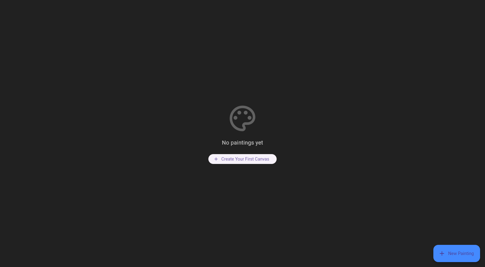</a><br>
      <sub>Gallery empty</sub>
    </td>
    <td align="center" width="50%">
      <a href="frontend/screenshots/02_create_dialog.png">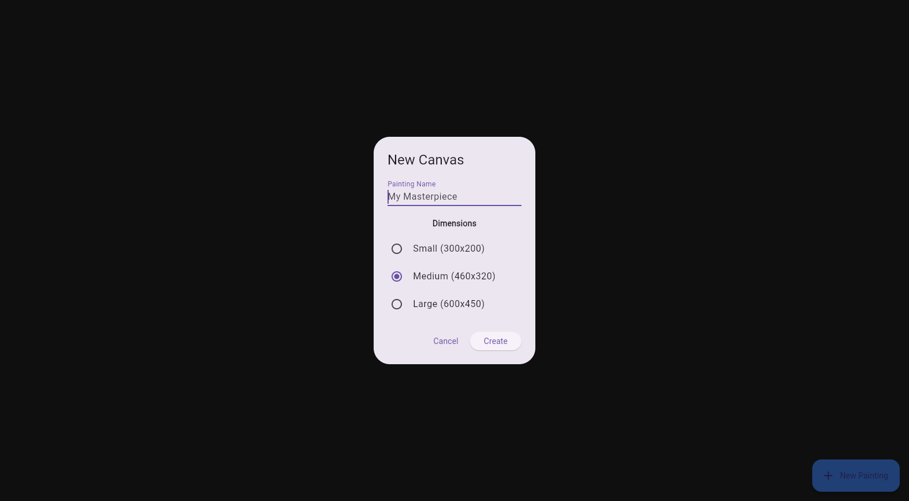</a><br>
      <sub>Create dialog</sub>
    </td>
  </tr>
  <tr>
    <td align="center" width="50%">
      <a href="frontend/screenshots/03_create_dialog_filled.png">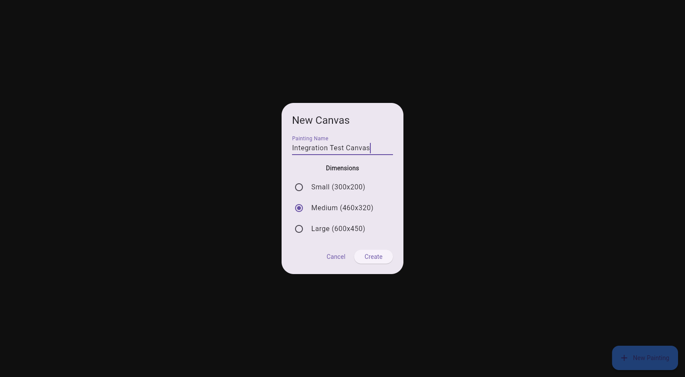</a><br>
      <sub>Create dialog filled</sub>
    </td>
    <td align="center" width="50%">
      <a href="frontend/screenshots/04_canvas_empty.png">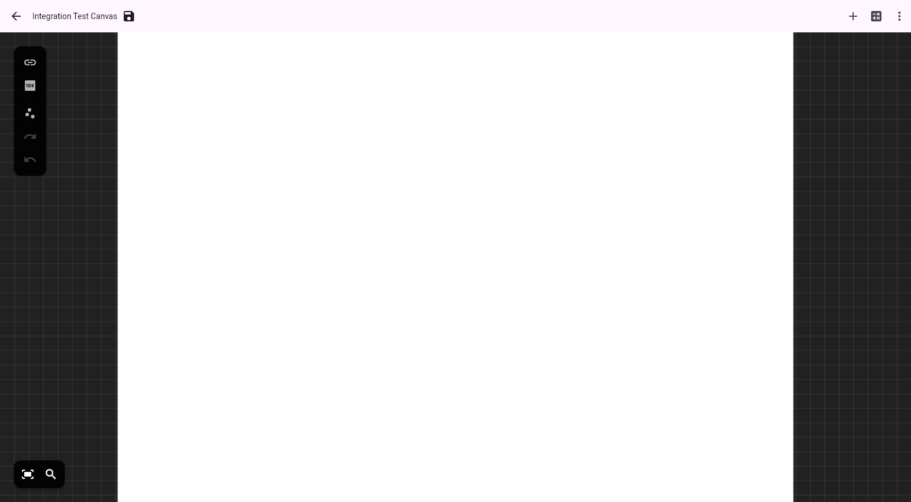</a><br>
      <sub>Canvas empty</sub>
    </td>
  </tr>
  <tr>
    <td align="center" width="50%">
      <a href="frontend/screenshots/05_one_shape.png">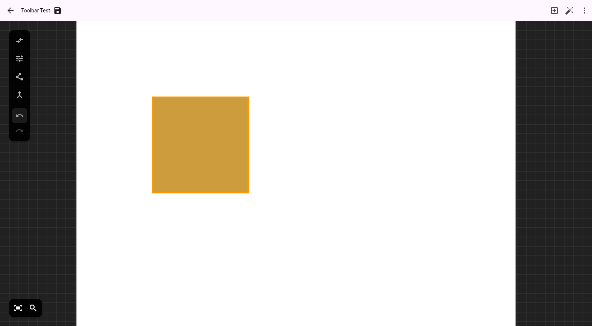</a><br>
      <sub>One shape</sub>
    </td>
    <td align="center" width="50%">
      <a href="frontend/screenshots/06_two_shapes.png">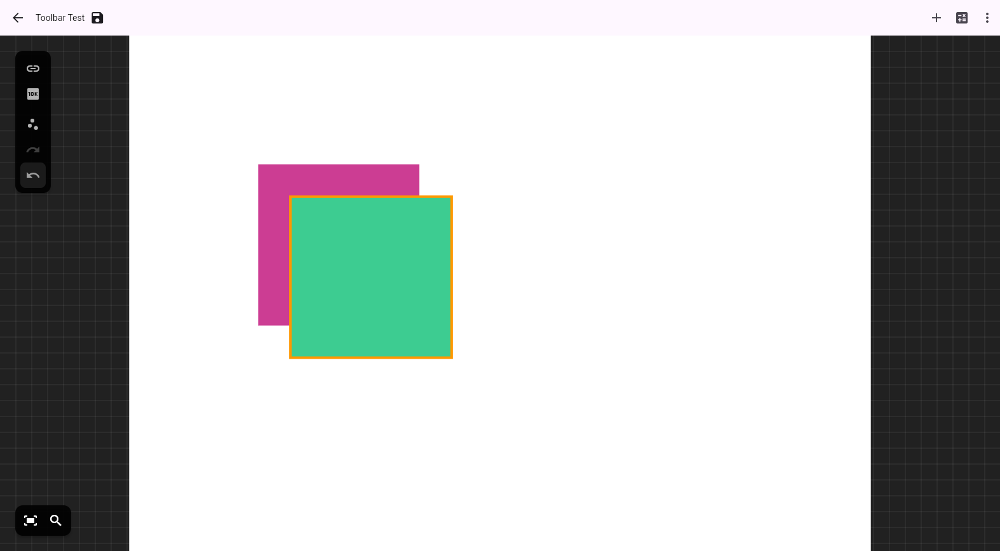</a><br>
      <sub>Two shapes</sub>
    </td>
  </tr>
  <tr>
    <td align="center" width="50%">
      <a href="frontend/screenshots/07_link_mode_active.png">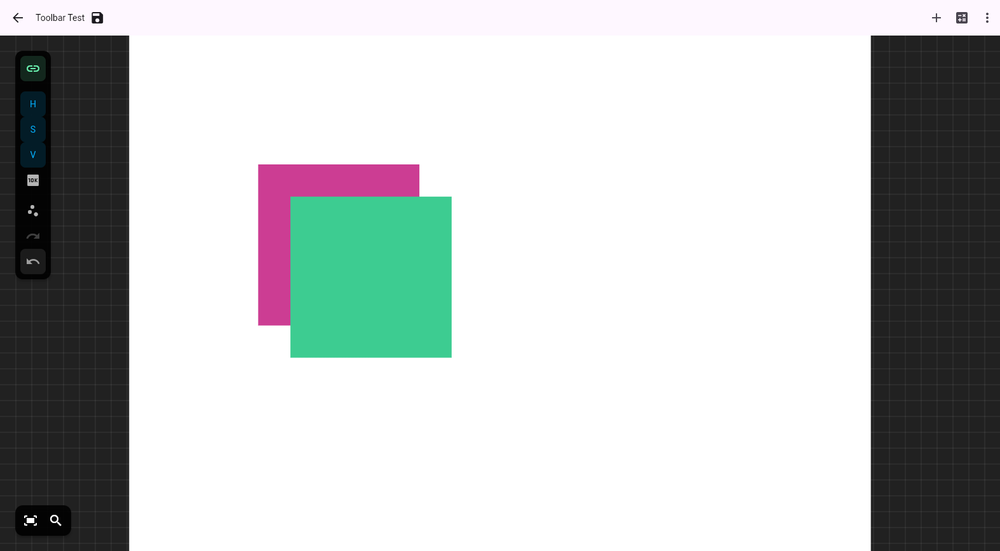</a><br>
      <sub>Link mode active</sub>
    </td>
    <td align="center" width="50%">
      <a href="frontend/screenshots/08_edit_vertices_mode.png">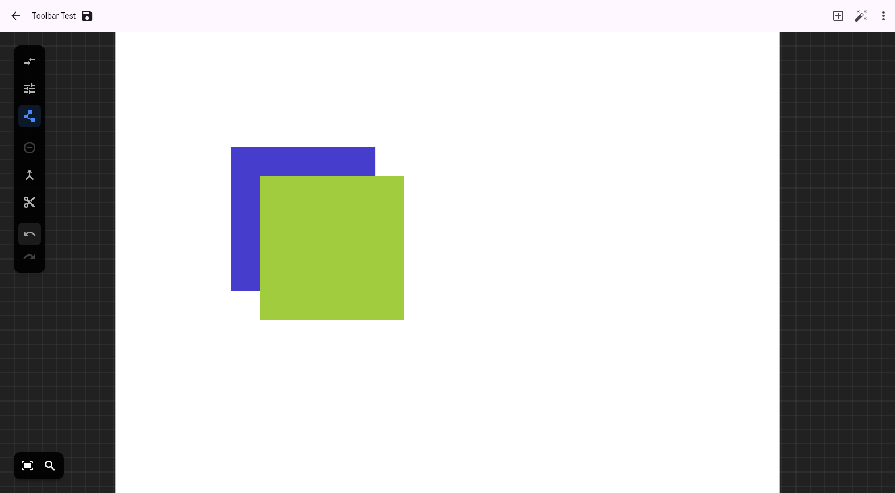</a><br>
      <sub>Edit vertices mode</sub>
    </td>
  </tr>
  <tr>
    <td align="center" width="50%">
      <a href="frontend/screenshots/09_after_undo.png">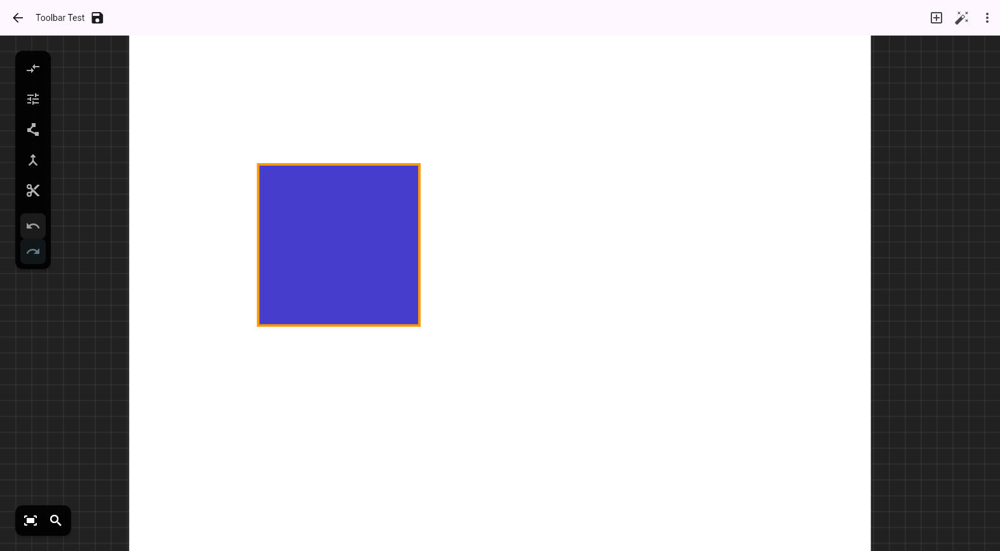</a><br>
      <sub>After undo</sub>
    </td>
    <td align="center" width="50%">
      <a href="frontend/screenshots/10_after_redo.png"></a><br>
      <sub>After redo</sub>
    </td>
  </tr>
  <tr>
    <td align="center" width="50%">
      <a href="frontend/screenshots/11_clamp_mode_no_selection.png">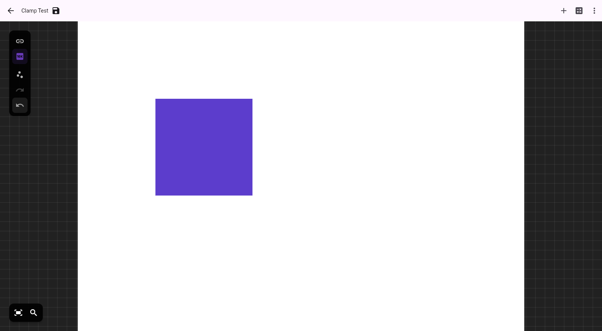</a><br>
      <sub>Clamp mode no selection</sub>
    </td>
    <td align="center" width="50%">
      <a href="frontend/screenshots/12_clamp_panel_open.png">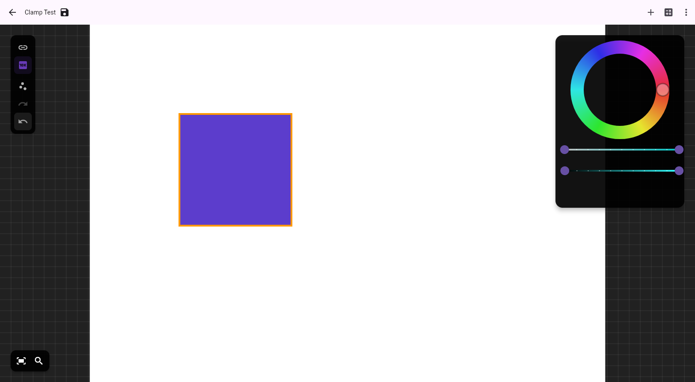</a><br>
      <sub>Clamp panel open</sub>
    </td>
  </tr>
  <tr>
    <td align="center" width="50%">
      <a href="frontend/screenshots/13_link_mode_two_selected.png">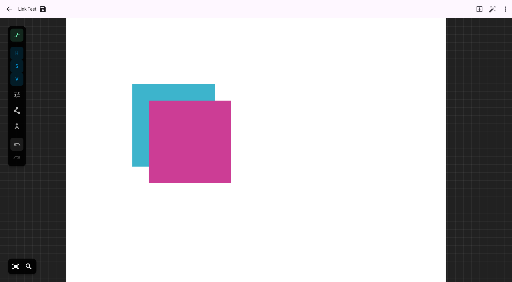</a><br>
      <sub>Link mode two selected</sub>
    </td>
    <td align="center" width="50%">
      <a href="frontend/screenshots/14_after_save.png">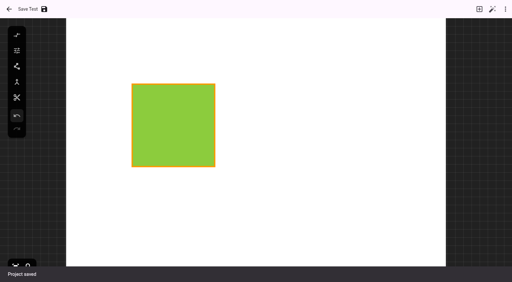</a><br>
      <sub>After save</sub>
    </td>
  </tr>
  <tr>
    <td align="center" width="50%">
      <a href="frontend/screenshots/15_gallery_with_project.png">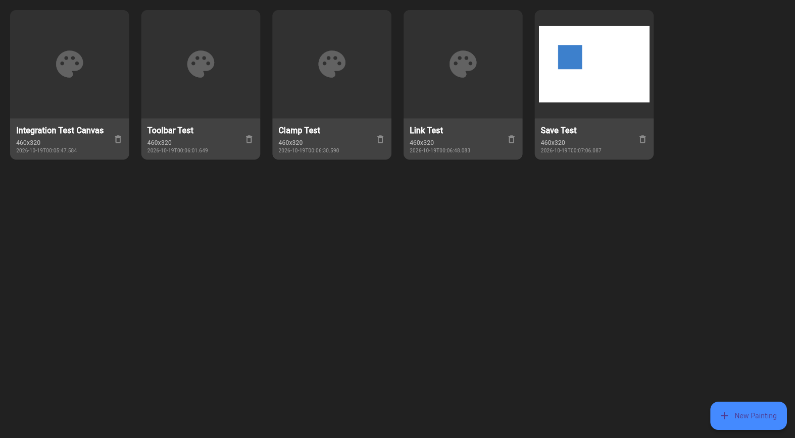</a><br>
      <sub>Gallery with project</sub>
    </td>
    <td align="center" width="50%">
      <a href="frontend/screenshots/16_snap_vertices_linked.png">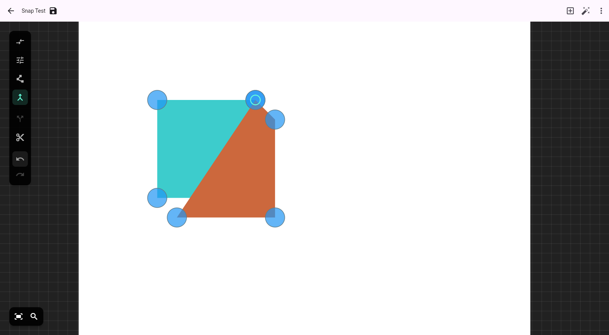</a><br>
      <sub>Snap vertices linked</sub>
    </td>
  </tr>
  <tr>
    <td align="center" width="50%">
      <a href="frontend/screenshots/17_snap_vertices_dragged.png"></a><br>
      <sub>Snap vertices dragged</sub>
    </td>
    <td align="center" width="50%">
      <a href="frontend/screenshots/18_snap_vertices_separated.png">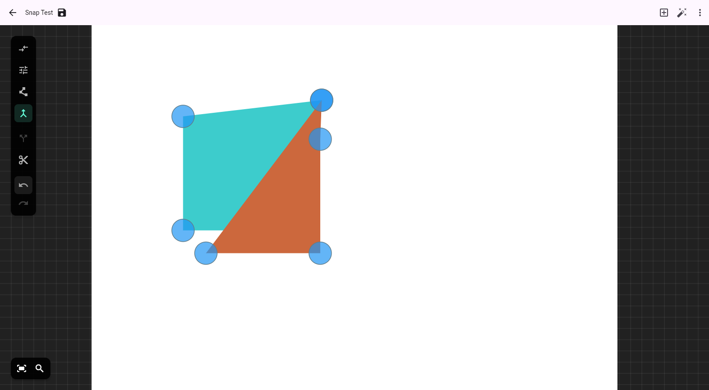</a><br>
      <sub>Snap vertices separated</sub>
    </td>
  </tr>
  <tr>
    <td align="center" width="50%">
      <a href="frontend/screenshots/19_split_first_vertex.png">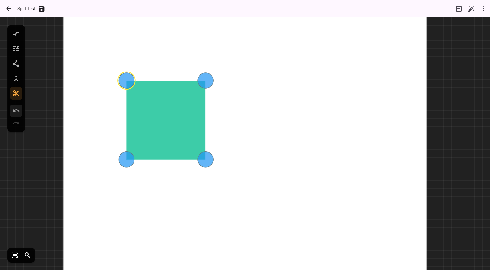</a><br>
      <sub>Split first vertex</sub>
    </td>
    <td align="center" width="50%">
      <a href="frontend/screenshots/20_split_shape.png">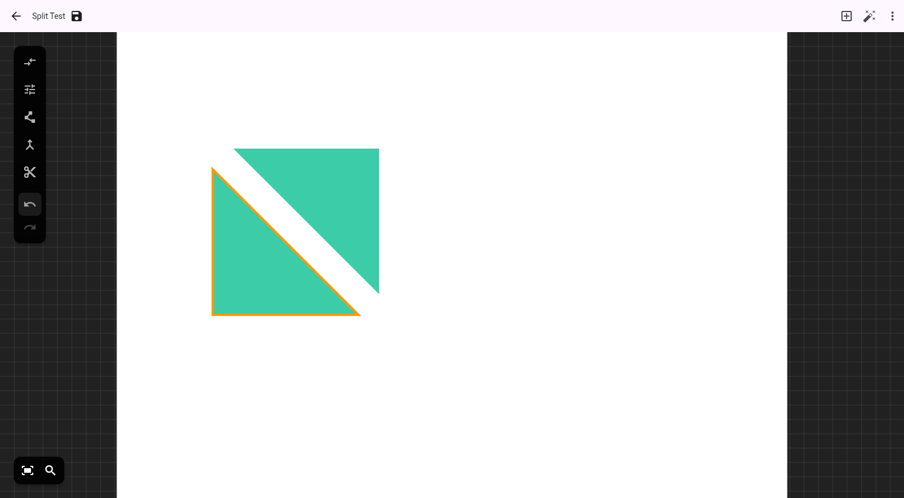</a><br>
      <sub>Split shape</sub>
    </td>
  </tr>
</table>

</details>
<!-- screenshots:end -->

---

## 🤖 The Vibecoding Experiment

Building a cross-language app (Dart/Flutter frontend + Java/Spring Boot backend) with algorithmic requirements is a true stress test for AI agents.

### 🛠️ The Agent Toolchain
* **TBD:** Add-hoc usage of agents

### 🧠 Managing "Comprehension Debt"
> **The Core Philosophy:** Pure vibecoding inevitably builds up "comprehension debt"—the gap between what the code does and what the developer actually understands.
>
> To combat this, manual coding was intentionally introduced whenever token limits were hit. This forced pause allowed for manual code review, refactoring, and mental synchronization with the AI-generated architecture, ensuring the project remained maintainable.

---

## 📦 Tech Stack

### Frontend
* **Framework:** Flutter (Web/Desktop)
* **Language:** Dart
* **State Management / Canvas:** Custom interactive vector canvas

### Backend
* **Framework:** Spring Boot (Java)
* **Optimization Engine:** Google OR-Tools (used for solving the shape relationships and color constraints linearly/combinatorially)
* **API:** REST for real-time constraint updates

---

## 🛠️ Local Setup

### Backend (Spring Boot)
Ensure you have Java 17+ and Maven installed.

Run:
```bash
   cd backend
   mvn spring-boot:run
```

### Frontend (Flutter)
Ensure you have the Flutter SDK installed and configured for Web.

Navigate to the frontend directory:

Install:
```bash
  cd frontend
  flutter pub get
```

Run:
```bash
  flutter run -d chrome
```

### 📄 License
Distributed under the MIT License. See [LICENSE](LICENSE) for more information.
